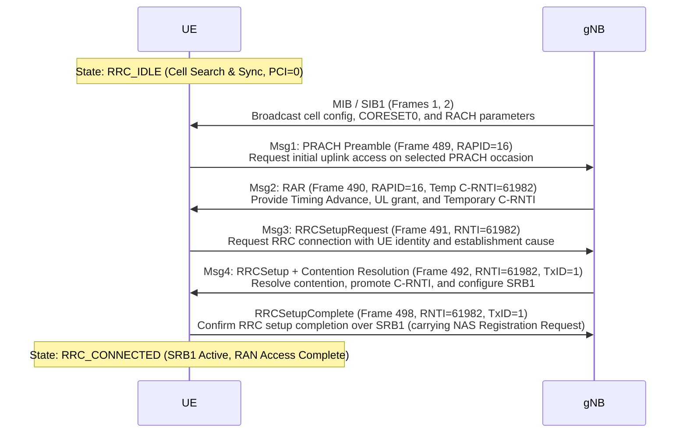

# Lab 5: From Initial Access to RRC Connection Setup

## 1. Lab Goal
The objective of this lab is to trace a successful 5G NR Initial Access procedure from cell search to `RRC_CONNECTED` using the provided OAI UE log (`Lab5-ue.log`) and Wireshark MAC-NR trace (`Lab5.pcap`). This report reconstructs the complete sequence—broadcast system information (MIB/SIB1), 4-step Random Access (Msg1–Msg4), and RRC Connection Setup—and distinguishes RAN access from 5GC registration.

---

## 2. Task 1: From Cell Search to Msg2 RAR

### Step 1: Find Cell Search and Initial Synchronization

**Extracted Values (`Lab5-ue.log`):**
* **Cell Search Start:** Line `56` (`Starting cell search with center freq: 3619200000, bandwidth: 106`)
* **Initial Synchronization:** Succeeded at Line `63` (`Initial sync successful`)
* **Physical Cell ID (PCI):** `0`

**Explanation:**
The UE successfully detected PSS/SSS and achieved time and frequency synchronization with PCI `0`. After completing initial synchronization, the UE is able to decode the Physical Broadcast Channel (PBCH) to read the Master Information Block (MIB) and begin acquiring cell system information.

---

### Step 2: Find MIB and SIB1

**Extracted Values (`Lab5.pcap`):**
* **SIB1 Frame number:** `1`
* **MIB Frame number:** `2`

**Explanation:**
MIB and SIB1 are periodically broadcast system-information messages that follow a dependency chain: **MIB** provides the essential physical-layer parameters (such as CORESET #0 and SearchSpace #0) telling the UE *where to look* for SIB1, while **SIB1** provides cell access parameters (PLMN, TAC, Cell ID) and RACH configuration (PRACH occasions, preambles, response window) telling the UE *how to access* the cell.

---

### Step 3: Find Msg1 PRACH

**Extracted Values:**
* **UE Log (`Lab5-ue.log`):** Line `81`
  * `frame.slot = 553.19`
  * `preambleIndex = 16`
* **Wireshark (`Lab5.pcap`):** Frame `489` (`MAC-LTE RACH Preamble chosen`)
  * `RAPID = 16`

**UE Log Evidence:**

**Wireshark Evidence:**

**Questions & Answers:**
1. **Which Random Access message is this PRACH transmission?**
   This is **Msg1** (the PRACH preamble transmission) of the 4-step Random Access procedure.
2. **At which `frame.slot` and with which `preambleIndex` does the UE log show transmission?**
   The UE log (line `81`) shows transmission at **`frame.slot = 553.19`** with **`preambleIndex = 16`**.
3. **Does the Wireshark `RAPID` match the UE-log `preambleIndex`? What does this show?**
   Yes, Wireshark `RAPID = 16` matches the UE log's `preambleIndex = 16`. This confirms that the gNB successfully received and identified the exact PRACH preamble transmitted by the UE.

---

### Step 4: Find Msg2 RAR in Wireshark

**Extracted Values (`Lab5.pcap`):**
* **Frame number:** `490`
* **RAPID:** `16`
* **Temporary C-RNTI:** `61982`

**Explanation:**
In Frame `490`, the gNB responds to the UE's preamble (`RAPID = 16`) with a **Random Access Response (Msg2)** addressed to `RA-RNTI = 271`. It provides Timing Advance (`TA = 0`), an uplink grant for Msg3, and assigns `Temporary C-RNTI = 61982` to the UE.

---

## 3. Task 2: Complete Random Access and RRC Connection Setup

### Step 1: Find `RRCSetupRequest` (Msg3)

**Extracted Values (`Lab5.pcap`):**
* **Frame number:** `491`
* **Context RNTI:** `61982` (`0xf21e`)

**Questions & Answers:**
1. **Does the `Context RNTI` match the `Temporary C-RNTI` in the Task 1 / Step 4 RAR? What does this show?**
   Yes, `Context RNTI = 61982` matches `Temporary C-RNTI = 61982` from the RAR. This shows that the UE successfully decoded Msg2 and used the assigned Temporary C-RNTI and uplink grant to transmit Msg3 (`RRCSetupRequest`).
2. **Can you claim that the RRC connection has been established after seeing only `RRCSetupRequest`? Why or why not?**
   No. `RRCSetupRequest` is only the UE's initial request to establish a connection; contention resolution has not yet completed, the gNB has not yet allocated SRB1/radio configurations via `RRCSetup`, and the UE has not yet confirmed with `RRCSetupComplete`.

---

### Step 2: Find `RRCSetup` (Msg4)

**Extracted Values (`Lab5.pcap`):**
* **Frame number:** `492`
* **Context RNTI:** `61982` (`0xf21e`)
* **rrc-TransactionIdentifier:** `1`
* **Contention Resolution present:** Yes (`LCID: UE Contention Resolution Identity (62)`)

**Questions & Answers:**
1. **Which message is this in four-step Random Access?**
   This is **Msg4** of the 4-step Random Access procedure.
2. **What does it mean that `Contention Resolution` and `RRCSetup` appear in the same downlink message?**
   It means the gNB resolves any potential preamble collision by echoing the UE's Contention Resolution Identity (confirming that this specific UE won the contention and promoting its Temporary C-RNTI to C-RNTI) while simultaneously delivering the `RRCSetup` configuration (such as SRB1 setup) in a single downlink transmission.

---

### Step 3: Find `RRCSetupComplete`

**Extracted Values (`Lab5.pcap`):**
* **Frame number:** `498`
* **Context RNTI:** `61982` (`0xf21e`)
* **rrc-TransactionIdentifier:** `1`

**Questions & Answers:**
1. **Does the `Context RNTI` still match the `Temporary C-RNTI` in the RAR?**
   Yes, the `Context RNTI` is still `61982` (`0xf21e`), which has now been promoted to the UE's permanent `C-RNTI` for this connection.
2. **Does the `rrc-TransactionIdentifier` match the `RRCSetup` in Step 2? What is the purpose of this comparison?**
   Yes, both have `rrc-TransactionIdentifier = 1`. Comparing this identifier verifies that `RRCSetupComplete` is the direct response corresponding to the specific `RRCSetup` transaction sent by the gNB in Frame `492`.

---

### Step 4: Confirm the Final Random Access and RRC Connection Result

**Extracted Values (`Lab5-ue.log`):**
* `4-Step RA procedure succeeded`: line `87`
* `Received NR_RRCSetup`: line `88`
* `State = NR_RRC_CONNECTED`: line `90`
* `Generating RRCSetupComplete`: line `93`

**Questions & Answers:**
1. **In log order, what are the three events from successful Random Access to generating `RRCSetupComplete`?**
   1. `Received NR_RRCSetup` (line `88`)
   2. `State = NR_RRC_CONNECTED` (line `90`)
   3. `Generating RRCSetupComplete` (line `93`)
2. **What do `4-Step RA procedure succeeded` and `State = NR_RRC_CONNECTED` each prove?**
   * `4-Step RA procedure succeeded` proves that MAC-layer Random Access and Contention Resolution completed successfully, establishing uplink synchronization and a valid C-RNTI.
   * `State = NR_RRC_CONNECTED` proves that the UE has transitioned from `RRC_IDLE` to `RRC_CONNECTED`, with SRB1 active and the radio-layer RRC connection established (which is distinct from 5GC NAS Registration that follows).

---

## 4. Task 3: Initial Access MSC Diagram

